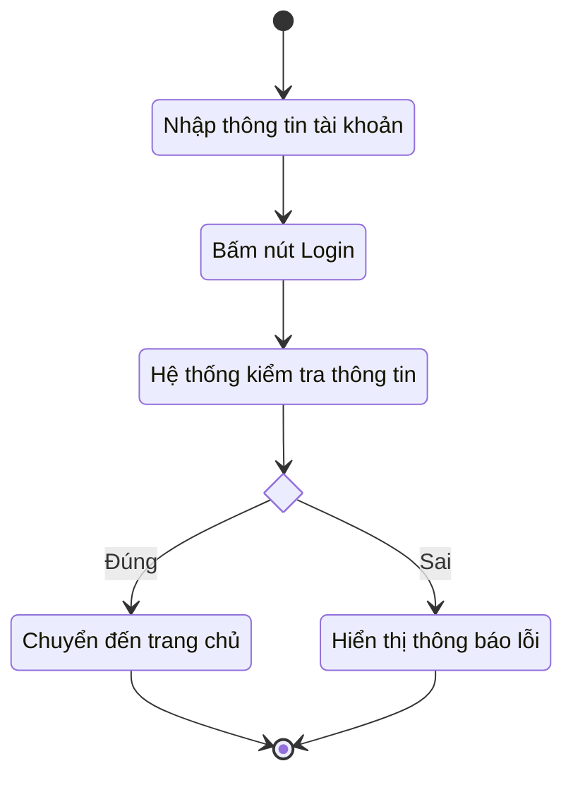
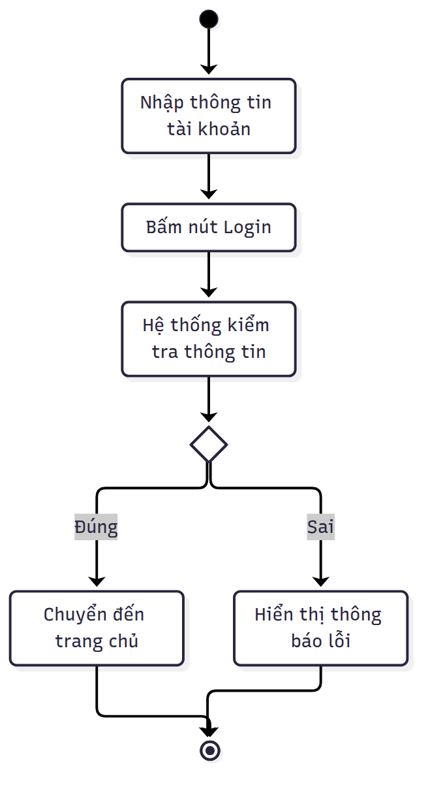

# Activity Diagram: Đăng nhập

## 1. Các bước

1. Nhập thông tin tài khoản.
2. Bấm nút Login.
3. Hệ thống kiểm tra thông tin.
4. Đúng: chuyển đến trang chủ, kết thúc. Sai: hiển thị thông báo lỗi, kết thúc.

## 2. Sơ đồ Activity (Mermaid)



## 3. Hình đã render



---

## 4. Prompt hướng dẫn vẽ (copy dùng với AI)

```text
Vẽ sơ đồ hoạt động (activity diagram) cho use case Đăng nhập bằng Mermaid stateDiagram-v2.
Luồng: [*] → Nhập thông tin tài khoản → Bấm nút Login → Hệ thống kiểm tra thông tin
→ rẽ nhánh (choice): Đúng → Chuyển đến trang chủ → kết thúc;
Sai → Hiển thị thông báo lỗi → kết thúc.
Khai báo state <<choice>> trước khi dùng. Nhãn tiếng Việt.
Chỉ trả về code trong khối ```mermaid.
```

## 5. Cách mở và render trong VS Code / Antigravity IDE

1. Mở file `.md` bằng VS Code hoặc Antigravity IDE.
2. Cài extension **Markdown Preview Mermaid Support** (`bierner.markdown-mermaid`).
   Có thể thêm **Markdown Preview Enhanced** hoặc **Mermaid Chart**.
3. Nhấn `Ctrl+Shift+V` để xem preview, hình mermaid sẽ hiện thay cho code.
4. Lưu ý: đặt cùng thư mục với `activity.png` để hình hiển thị.
