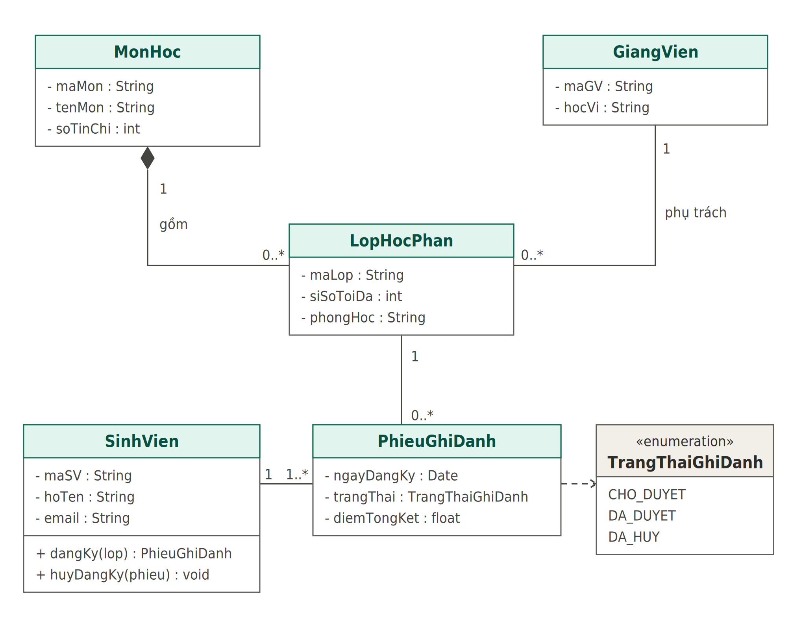
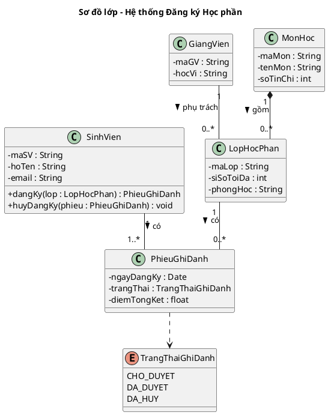

# Sơ đồ lớp - Hệ thống Đăng ký Học phần

## Mô tả quan hệ

| Quan hệ | Loại | Bội số |
|---|---|---|
| MonHoc - LopHocPhan | Hợp thành (composition) | 1 - 0..* |
| GiangVien - LopHocPhan | Kết hợp (association) | 1 - 0..* |
| SinhVien - PhieuGhiDanh | Kết hợp | 1 - 1..* |
| LopHocPhan - PhieuGhiDanh | Kết hợp | 1 - 0..* |
| PhieuGhiDanh - TrangThaiGhiDanh | Phụ thuộc (dependency) | - |

Xóa một `MonHoc` thì toàn bộ `LopHocPhan` thuộc môn đó bị xóa theo.

## Mã PlantUML

