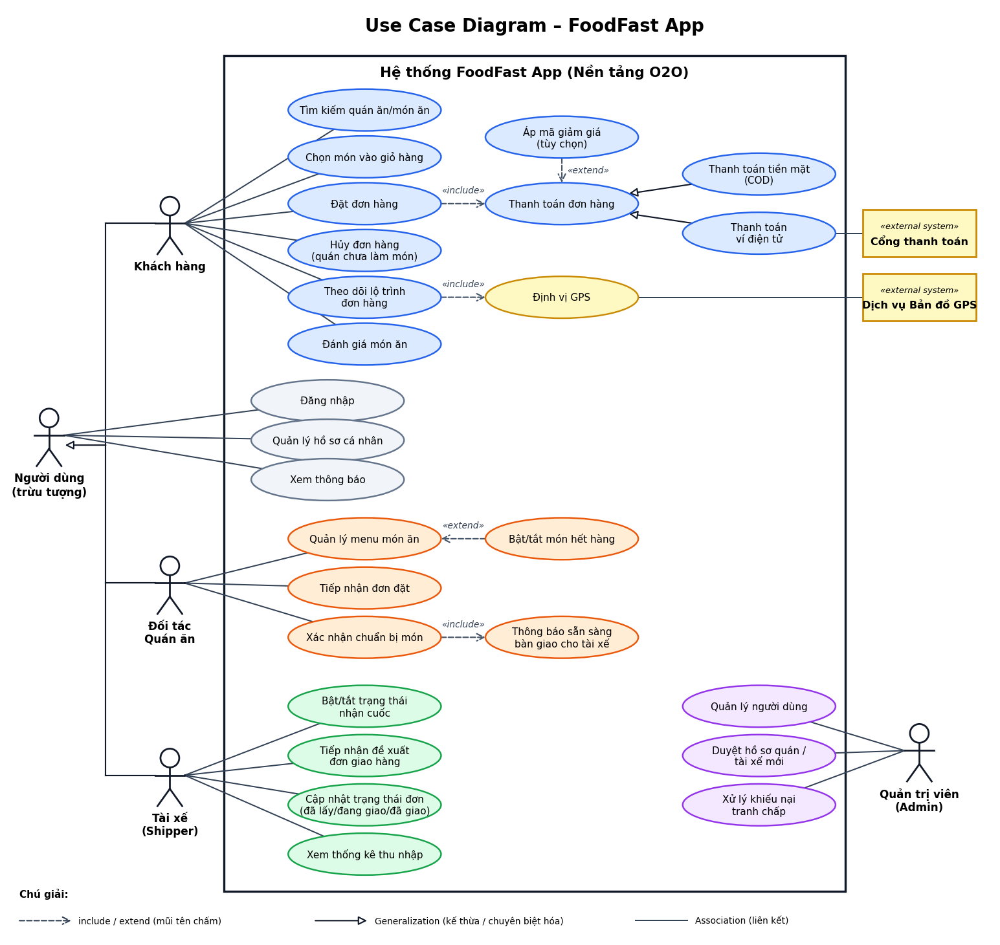
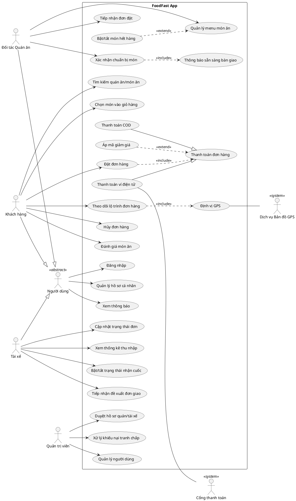

# Bối cảnh nghiệp vụ – FoodFast App

> Mô hình ứng dụng siêu kết nối kinh tế chia sẻ (O2O – Online to Offline) tương tự GrabFood / ShopeeFood.
> **Mục tiêu:** Biểu diễn chính xác sự cộng tác mà không nhầm lẫn sang Sequence Diagram.

---

## 1. Xác định Actor

| Actor | Loại | Vai trò |
|---|---|---|
| **Người dùng** | Trừu tượng (abstract) | Actor cha, gom các thao tác chung của 3 vai trò |
| **Khách hàng** | Chính | Tìm món, đặt hàng, thanh toán, theo dõi, hủy, đánh giá |
| **Đối tác Quán ăn** | Chính | Quản lý menu, nhận đơn, chuẩn bị món, báo sẵn sàng |
| **Tài xế (Shipper)** | Chính | Nhận cuốc, giao hàng, cập nhật trạng thái, xem thu nhập |
| **Quản trị viên (Admin)** | Chính | Quản lý người dùng, duyệt hồ sơ, xử lý khiếu nại |
| **Cổng thanh toán** | Hệ thống ngoài | Xử lý thanh toán ví điện tử |
| **Dịch vụ Bản đồ GPS** | Hệ thống ngoài | Cung cấp định vị và lộ trình theo thời gian thực |

## 2. Danh sách Use Case theo Actor

### Chung (Người dùng)
| Use case | Ghi chú |
|---|---|
| Đăng nhập | Dùng chung cho Khách hàng, Quán ăn, Tài xế |
| Quản lý hồ sơ cá nhân | Dùng chung |
| Xem thông báo | Dùng chung |

### Khách hàng
| Use case | Quan hệ |
|---|---|
| Tìm kiếm quán ăn / món ăn | Association |
| Chọn món vào giỏ hàng | Association |
| Đặt đơn hàng | Association; `<<include>>` Thanh toán đơn hàng |
| Thanh toán đơn hàng | Cha của COD / Ví điện tử |
| Áp mã giảm giá | `<<extend>>` Thanh toán đơn hàng |
| Theo dõi lộ trình đơn hàng | Association; `<<include>>` Định vị GPS |
| Hủy đơn hàng | Association (điều kiện: quán chưa bắt đầu làm món) |
| Đánh giá món ăn | Association (sau khi nhận hàng) |

### Đối tác Quán ăn
| Use case | Quan hệ |
|---|---|
| Quản lý menu món ăn | Association |
| Bật/tắt món hết hàng | `<<extend>>` Quản lý menu món ăn |
| Tiếp nhận đơn đặt | Association |
| Xác nhận chuẩn bị món | Association; `<<include>>` Thông báo sẵn sàng bàn giao |
| Thông báo sẵn sàng bàn giao cho tài xế | Được include |

### Tài xế
| Use case |
|---|
| Bật/tắt trạng thái nhận cuốc |
| Tiếp nhận đề xuất đơn giao hàng |
| Cập nhật trạng thái đơn (đã lấy món / đang giao / đã giao thành công) |
| Xem thống kê thu nhập |

### Quản trị viên
| Use case |
|---|
| Quản lý người dùng |
| Duyệt hồ sơ quán / tài xế mới |
| Xử lý khiếu nại tranh chấp |

---

## 3. Giải đáp "Thách thức tư duy thiết kế"

### 3.1. Kế thừa Actor
Tạo actor trừu tượng **Người dùng** và dùng quan hệ **Generalization** từ *Khách hàng*, *Đối tác Quán ăn*, *Tài xế* về *Người dùng*. Các use case chung (**Đăng nhập, Quản lý hồ sơ cá nhân, Xem thông báo**) chỉ nối **một lần** với actor cha; 3 actor con tự động thừa hưởng. Nhờ vậy không phải kéo 9 đường nối chồng chéo.

> Admin không nằm trong nhóm kế thừa vì đề bài chỉ nêu "Khách hàng, Quán ăn, Tài xế" là các bên có điểm chung này.

### 3.2. Hệ thống bên ngoài
| Hệ thống ngoài | Đặt ở | Liên kết với use case | Lý do |
|---|---|---|---|
| Cổng thanh toán | Ngoài ranh giới hệ thống, bên phải | **Thanh toán ví điện tử** | COD không qua cổng, chỉ ví điện tử mới cần |
| Dịch vụ Bản đồ GPS | Ngoài ranh giới hệ thống, bên phải | **Định vị GPS** | Cung cấp dữ liệu vị trí cho việc theo dõi lộ trình |

### 3.3. Phân biệt Include vs Extend
| Tình huống | Quan hệ | Giải thích |
|---|---|---|
| Áp mã giảm giá | **Extend** Thanh toán đơn hàng | **Tùy chọn** – khách có thể không dùng mã; hành vi chỉ xảy ra khi có điều kiện |
| Định vị GPS khi theo dõi đơn | **Include** | **Bắt buộc** – không có vị trí thì không thể theo dõi lộ trình |
| Hủy đơn hàng | **Use case độc lập** (Association với Khách hàng) | Là mục tiêu riêng của khách, có điều kiện tiên quyết "quán chưa bắt đầu làm món". Có thể mô hình hóa là `<<extend>>` của *Đặt đơn hàng* nếu giảng viên yêu cầu, nhưng không phải include |
| Đặt đơn → Thanh toán | **Include** | Đặt đơn luôn phải kèm bước thanh toán |
| Bật/tắt món hết hàng | **Extend** Quản lý menu | Chỉ xảy ra trong một số lần quản lý menu |
| Xác nhận chuẩn bị món → Thông báo sẵn sàng | **Include** | Xác nhận xong luôn kéo theo thông báo cho tài xế |

> **Mẹo nhớ:** *Include* = "luôn luôn phải có". *Extend* = "có thể có, tùy điều kiện".

### 3.4. Generalization của Use Case
**Thanh toán đơn hàng** (use case cha) được chuyên biệt hóa thành:
- **Thanh toán tiền mặt (COD)**
- **Thanh toán ví điện tử** (liên kết với Cổng thanh toán)

Có thể mở rộng thêm: thẻ ngân hàng, QR, ví nội bộ FoodFast…

---

## 4. Đặc thù nghiệp vụ: phối hợp 3 bên (không dùng Sequence Diagram)

Một đơn hàng luân chuyển **Khách đặt → Quán làm → Shipper giao**. Use Case Diagram chỉ thể hiện *ai làm được gì*, còn thứ tự thời gian thuộc về Sequence Diagram. Sự phối hợp được thể hiện qua các use case "bàn giao":

| Bước | Actor | Use case | Kết quả |
|---|---|---|---|
| 1 | Khách hàng | Đặt đơn hàng (+ Thanh toán) | Đơn được tạo |
| 2 | Quán ăn | Tiếp nhận đơn đặt | Đơn được xác nhận |
| 3 | Quán ăn | Xác nhận chuẩn bị món → Thông báo sẵn sàng | Tài xế nhận tín hiệu |
| 4 | Tài xế | Tiếp nhận đề xuất đơn giao hàng | Tài xế nhận cuốc |
| 5 | Tài xế | Cập nhật trạng thái đơn | Đã lấy món / đang giao / đã giao |
| 6 | Khách hàng | Theo dõi lộ trình (+ GPS) | Thấy tài xế di chuyển |
| 7 | Khách hàng | Đánh giá món ăn | Đóng đơn hàng |

---

## 5. Mã PlantUML (tùy chọn, để chỉnh sửa/xuất lại sơ đồ)

