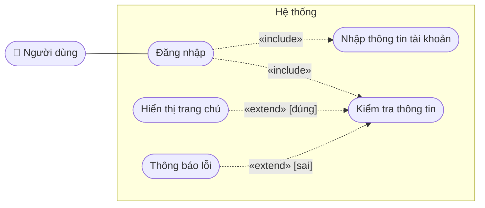
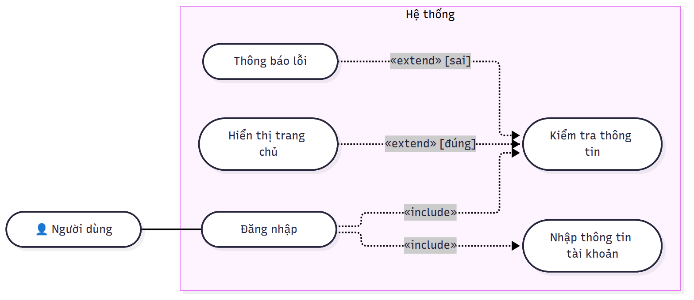

# Use Case: Đăng nhập

## 1. Mô tả use case

| Mục | Nội dung |
|---|---|
| Tên | Đăng nhập |
| Actor | Người dùng |
| Tiền điều kiện | Người dùng chưa đăng nhập |
| Luồng chính | Nhập thông tin tài khoản → Bấm Login → Hệ thống kiểm tra → Đúng: vào trang chủ |
| Luồng thay thế | Thông tin sai: hệ thống hiển thị thông báo lỗi |
| Hậu điều kiện | Thành công: vào trang chủ. Thất bại: ở lại trang đăng nhập |

## 2. Sơ đồ Use Case (Mermaid)



## 3. Hình đã render



---

## 4. Prompt hướng dẫn vẽ (copy dùng với AI)

```text
Vẽ sơ đồ use case cho chức năng Đăng nhập bằng Mermaid (flowchart LR).
- Actor: Người dùng, đặt bên trái.
- Hệ thống là một subgraph chứa các use case: Đăng nhập, Nhập thông tin tài khoản,
  Kiểm tra thông tin, Hiển thị trang chủ, Thông báo lỗi.
- Đăng nhập «include» Nhập thông tin tài khoản và Kiểm tra thông tin.
- Hiển thị trang chủ «extend» Kiểm tra thông tin, điều kiện [đúng].
- Thông báo lỗi «extend» Kiểm tra thông tin, điều kiện [sai].
- Chỉ trả về code trong khối ```mermaid, nhãn tiếng Việt.
```

## 5. Cách mở và render trong VS Code / Antigravity IDE

1. Mở file `.md` bằng VS Code hoặc Antigravity IDE.
2. Cài extension (mở Extensions: `Ctrl+Shift+X`):
   - **Markdown Preview Mermaid Support** (`bierner.markdown-mermaid`): render mermaid trong Markdown Preview.
   - (Tuỳ chọn) **Mermaid Chart** (`MermaidChart.vscode-mermaid-chart`) hoặc **Markdown Preview Enhanced** (`shd101wyy.markdown-preview-enhanced`).
3. Bấm `Ctrl+Shift+V` (hoặc `Ctrl+K V` để mở song song) để xem hình.
4. Antigravity IDE dựa trên nền VS Code, cài extension từ Open VSX với đúng tên trên.
5. Xuất ảnh: dùng `npx @mermaid-js/mermaid-cli -i file.mmd -o file.png`.
